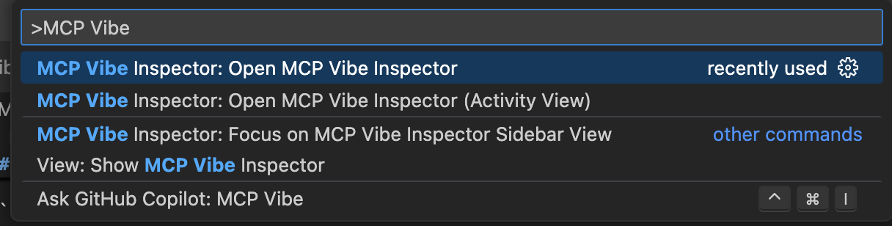

# MCP Vibe Inspector


Debug and inspect Model Context Protocol (MCP) servers right inside VS Code.

This extension embeds the MCP Vibe Inspector in a Webview Panel and provides a lightweight sidebar to quickly configure and launch your Inspector instance—no context switch to the browser needed.


## ✨ Features

- 🚀 **Launch Inspector instantly** in VS Code—no browser needed
- 🛠️ **Setup Inspector** in one click from the sidebar
- 🔗 **Paste your Inspector URL** and go
- 🧑‍💻 **Debug multiple servers** in separate tabs
- 🔑 **Easy token & URL fields** with copy buttons


## 🚀 Getting Started (Super Simple!)

1. **Setup the Inspector**
  - Open VS Code.
  - Find the MCP Vibe Inspector icon in the Activity Bar (left side).
  - Click the **🛠️ Setup Inspector** button in the sidebar. This opens the Inspector in your terminal.
  - If it doesn't work, just copy the command shown and paste it in your terminal:
    ```
    npx @modelcontextprotocol/inspector
    ```

2. **Get your Inspector URL**
  - After starting, look in the terminal for a link like:
    ```
    http://localhost:6274/?MCP_PROXY_AUTH_TOKEN=yourtoken
    ```
  - Copy this link.

3. **Paste the Inspector URL in the sidebar**
  - Find the **Inspector URL** box in the sidebar.
  - Paste your link there.
  - If you have a Proxy Session Token, enter it in the box below—the Inspector URL will update automatically.

4. **Click Open Inspector**
  - Click the big blue **Open Inspector** button.
  - The Inspector panel opens with your exact URL—no guessing, no old values!

5. **(Optional) Enter Bearer Token and MCP URL**
  - If you need these for your server, enter them in the sidebar fields.
  - Use the copy buttons to quickly copy values for other tools.

6. **Done!**
  - You can now debug and inspect your MCP server right inside VS Code.
  - Open more Inspector panels/tabs if you want to debug multiple servers at once.

**Tip:** If you ever need to change the Inspector URL, just update the box in the sidebar and click **🚀 Launch Inspector** again.


## 🧭 Commands

- `MCP Vibe Inspector: Open MCP Vibe Inspector` (mcp-debugger.openInspector)
- `MCP Vibe Inspector: Open MCP Vibe Inspector (Activity View)` (mcp-debugger.openInspectorInView)




## 📝 Sidebar Fields (What They Do)

- **Inspector URL**: Paste the Inspector URL (with token) here. This is the link you get from the terminal after starting the Inspector.
- **Proxy Session Token**: Enter your token here if you have one. The Inspector URL will update automatically.
- **Bearer Token**: Enter your Bearer Token for authentication. Use the copy icon to copy it.
- **MCP URL**: Enter your MCP server URL. Use the copy icon to copy it.

- `mcpDebugger.inspectorUrl` (string)
  - Default: `http://localhost:3000`
  - The URL where MCP Vibe Inspector is running. Must be http/https and typically includes `MCP_PROXY_AUTH_TOKEN`.

Settings UI: File → Preferences → Settings → search for “MCP Vibe Inspector”.


## 🔧 Troubleshooting (If You Get Stuck)

- “Still loading…” overlay appears
  - The Inspector may be slow or unreachable. Verify the URL and network, then use Retry.
- “Failed to load the inspector”
  - Check that your Inspector process is running and accessible from VS Code.
- Invalid URL error
  - Ensure the URL starts with http/https and includes the `MCP_PROXY_AUTH_TOKEN` query parameter when required.


## ❓ FAQ (Quick Answers)

- Does this extension send telemetry?
  - No. There is no telemetry.
- Can I open in a separate window instead?
  - The extension focuses on an embedded experience; you can still open the same URL in your browser if preferred.

## 🧩 What is MCP?

The Model Context Protocol (MCP) is an open protocol that enables LLM apps to discover and call external tools and data sources. The MCP Vibe Inspector is a debugging UI to explore, validate, and troubleshoot MCP servers.


## 🛠 Development (For Advanced Users)

```bash
git clone https://github.com/abcSTARK/vscode-mcp-debugger
cd vscode-mcp-debugger
npm install
# Press F5 in VS Code to launch the Extension Development Host
```

Build/lint/test:

```bash
npm run compile
npm run lint
npm test
```

Or use the development environment check script:

```bash
./scripts/check-dev-env.sh
```

## 🤝 Contributing

Issues and PRs are welcome. See `CONTRIBUTING.md` and `CODE_OF_CONDUCT.md`.

This repository uses branch protection rules requiring:
- Code owner approval for all changes
- Passing CI tests (lint, compile, package)
- Pull request workflow (no direct pushes to main)

For more details, see [`.github/BRANCH_PROTECTION_SETUP.md`](.github/BRANCH_PROTECTION_SETUP.md).

## 🔒 Security

Please see `SECURITY.md` for how to report a vulnerability.

## 📄 License

MIT © 2025 abcSTARK
